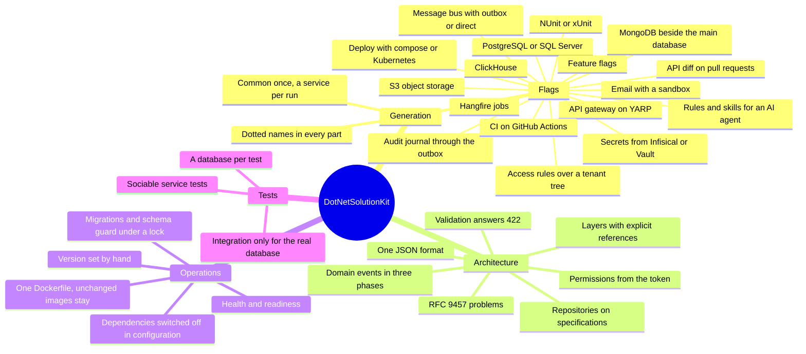

# Documentation

**DotNetSolutionKit (dotskit)** generates a .NET solution to a team's needs - the frame for DDD and Clean Architecture, CI, deployment and tests, with modules and integrations with infrastructure services turned on by flags. `dotskit` adds services to the solution and flags to its services. The generated solution is an ordinary .NET solution the team owns.

`dotskit upgrade` brings the template's later improvements into a generated solution under the team's control and helps the team maintain its solution: a three-way merge with the team's code, where what does not merge is a conflict for the team to resolve.

What the template gives a solution, at a glance:

## Getting started

- [dotskit](getting-started/dotskit.md): the contents of the project - what dotskit is and which page to open
- [What the template gives](getting-started/what-it-gives.md): what a solution gets, the principles, the cost and the risks
- [Generating a solution](getting-started/template.md): install, parameters, dotted names, running locally
- [The layout of a solution](getting-started/layout.md): the folders, the projects of one service, how the template and the tool meet
- [The dotskit tool](getting-started/tool.md): the tool that makes a solution, adds services and flags to it,
  describes a solution made without it and upgrades a solution, keeping the team's changes
- [Upgrading a solution](getting-started/upgrading.md): the course of an upgrade, its repairs, the versions it covers, what a release asks by hand
- [Working with AI agents](getting-started/agents.md): the rules and skills a solution gets

## Architecture

- [Projects and layers](architecture/projects-and-layers.md)
- [Web layer](architecture/web-layer.md): the host and the pipeline every service shares
- [Errors](architecture/errors.md): RFC 9457 problems
- [Validation and pagination](architecture/validation-and-pagination.md)
- [Authentication and permissions](architecture/authentication-and-permissions.md)
- [Persistence](architecture/persistence.md): schemas, migrations, repositories, search
- [Settings](architecture/settings.md): their sources, and what changes while a service runs
- [Domain events](architecture/domain-events.md)
- [Testing](architecture/testing.md)
- [Code style](architecture/code-style.md): the rules of every file and how CI holds them

## Features

- [Background jobs](features/background-jobs.md): Hangfire, `--Hangfire`
- [Message bus](features/messaging.md): MassTransit, `--Messaging`
- [Secrets from Infisical or Vault](features/secrets.md): `-I`, `--Vault`
- [Feature flags](features/feature-flags.md): `--FeatureFlags`
- [API diff](features/api-diff.md): `--DiffApi`
- [CI on GitHub Actions](features/ci.md): `--GitHubCiCd`
- [Access rules over a tenant tree](features/hierarchy-rules.md): `--HierarchyRules`
- [Object storage](features/object-storage.md): S3-compatible, `--Storage`
- [ClickHouse](features/clickhouse.md): `--ClickHouse`
- [MongoDB](features/mongodb.md): `--MongoDB`
- [Notifications](features/notifications.md): email, `--Notify`
- [Audit journal](features/audit.md): `--Audit`, with `--Messaging outbox`
- [API gateway](features/api-gateway.md): YARP, `--ApiGateway`

## Operations

- [Docker](operations/docker.md): one Dockerfile, only changed services rebuilt
- [Deployment](operations/deployment.md): docker compose or Kubernetes, `--Deploy`
- [Health](operations/health.md): `/health` and `/ready`
- [Startup checks](operations/startup-checks.md)
- [Switching dependencies off](operations/switching-dependencies-off.md): run without the database, the
  jobs, the bus or the secret store, and turn them on later

## Decisions

Where the template departs from a common practice, and why.

- [ADR-001: Domain events run in three phases tied to the transaction](adr/001-three-phase-domain-events.md)
- [ADR-002: Repositories take queries as specifications](adr/002-repositories-on-specifications.md)
- [ADR-003: The API document is read from the built application](adr/003-api-schema-generation.md)
- [ADR-004: The product version is set by hand](adr/004-product-version-by-hand.md)
- [ADR-005: How a service is tested](adr/005-testing-a-service.md)
- [ADR-006: JSON metadata keys](adr/006-json-metadata-key-convention.md)
- [ADR-007: One code style, owned by the formatters](adr/007-code-style.md)

## [Roadmap](roadmap.md)

What is planned, and where the template ties a team to one technology.
