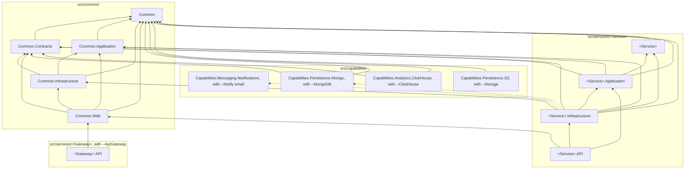

# Projects and layers

A generated solution has three parts: the shared `Common` projects under `src/common`, generated once; a
project per capability a flag brings under `src/capabilities`; and one folder per service under `src/services`.

Who references whom; an arrow points at the project referenced:

## Common

| Project | Holds | References |
|---|---|---|
| `Common` | The domain kernel: `Entity`, `AggregateRoot`, domain events, `IUnitOfWork`, specifications, the user and execution context, exceptions | nothing |
| `Common.Contracts` | What crosses a service boundary: routes, request and response models, health constants | `Common` |
| `Common.Application` | Application abstractions: the domain event dispatcher, `IPermissionService`, messaging and tracing interfaces | `Common` |
| `Common.Infrastructure` | EF Core base classes, interceptors, repositories, migrations, the schema guard, messaging on MassTransit, security | `Common`, `Common.Application`, `Common.Contracts` |
| `Common.Web` | The web layer of a service: pipeline, errors, validation, Swagger, authentication, permissions, health | `Common`, `Common.Contracts`, `Common.Application`, `Common.Infrastructure` |
| `Common.Testing` | Test helpers tied to the audit pipeline: the audit verifiers and `TestCategories`; no test framework | all of the above, `Framework.Testing` |
| `Framework.Testing` | The portable testing harness: the test contexts, the real-database test servers of the solution's database (`PostgresDbTestExecutionContext`, `SqlServerDbTestExecutionContext`), `TestDatabase`, the stubs, the rule checks; no test framework | `Common`, `Common.Application`, `Common.Infrastructure`, `Framework.DomainEvents`, the provider module |
| `Common.Tests` | The tests of `Common` | all of the above, `Common.Testing` |
| `Framework.FeatureFlags`, with `--FeatureFlags` | The platform feature flags: the shared `features.json` catalogue, the Microsoft.FeatureManagement wiring, `GET /api/v1/features`, the Swagger filters for `[FeatureGate]`. A service with the flag references it | nothing of `Common` |
| `Framework.FeatureFlags.Tests` | The tests of feature flags | `Framework.FeatureFlags` |
| `Capabilities.Messaging.Notifications` | Email of `--Notify email`: the port, the SMTP and Graph transports, the sandbox. A service with the flag references it, so only that service carries MailKit and the Graph SDK | nothing of `Common` |
| `Capabilities.Messaging.Notifications.Tests` | The tests of email | `Capabilities.Messaging.Notifications`, `Common.Testing` |
| `Capabilities.Persistence.Mongo` | MongoDB of `--MongoDB`: the store, its options, its health check. A service with the flag references it, so only that service carries the driver | `Common`, `Common.Contracts` |
| `Capabilities.Persistence.Mongo.Tests` | The tests of MongoDB | `Capabilities.Persistence.Mongo`, `Common`, `Common.Testing` |
| `Capabilities.Analytics.ClickHouse` | ClickHouse of `--ClickHouse`: connections, the schema guard, the readiness check. A service with the flag references it, so only that service carries the driver | `Common`, `Common.Contracts` |
| `Capabilities.Analytics.ClickHouse.Tests` | The tests of ClickHouse | `Capabilities.Analytics.ClickHouse`, `Common`, `Common.Testing` |
| `Capabilities.Persistence.Abstractions` | The persistence contracts the kernel and the providers share: `IMigrationLock`, `IShortIdGenerator`, `IOutboxStatsDialect`, `MigrationLockKey` | nothing |
| `Capabilities.Persistence.S3` | Object storage of `--Storage`: `IS3ObjectStorage`, its settings, the null double. A service with the flag references it, so only that service carries the AWS SDK | `Common` |
| `Capabilities.Persistence.S3.Tests` | The tests of object storage | `Capabilities.Persistence.S3`, `Common`, `Common.Testing` |

## A service

| Project | Holds | References |
|---|---|---|
| `<Service>` | The service's domain: entities, aggregates, domain events, policies | `Common` |
| `<Service>.Application` | Use cases, domain event handlers, ports the infrastructure implements | `Common`, `Common.Application`, `Common.Contracts`, the domain |
| `<Service>.Infrastructure` | The `DbContext`, entity configurations, repositories, jobs, consumers | the domain, `Common`, `Common.Application`, `Common.Contracts`, `Common.Infrastructure`, the application |
| `<Service>.API` | Controllers, `Program`, the host setup | the `Common` projects, the application, the infrastructure |
| `<Service>.Tests` | The service's tests | `Framework.Testing`, `Common.Testing`, the `Common` projects, the service's projects |

The API project does not reference the domain: it works with the domain through the application layer,
which registers the domain services too. The application layer answers with the request and response
types of `Common.Contracts` and throws the exceptions of `Common`, so it references both; the
infrastructure references `Common.Contracts` for the bus messages its consumers receive. The infrastructure references the domain directly, because EF Core
maps the domain's entities and there are no separate persistence models to translate.

## Every reference is explicit

`Directory.Build.props` sets `DisableTransitiveProjectReferences`. A project sees only the projects it
references itself, not the projects those reference. Without it, the API project could use a domain type
through the application project, and the layering above would hold only as long as nobody tried. With it,
crossing a layer is a compile error, and adding a dependency is a visible line in a `.csproj`.

Packages still flow transitively; only project references are cut.

## Packages and versions

Package versions are declared once, in `src/Directory.Packages.props` or in a file it imports; a `.csproj`
names a package without a version. Every package stays on the .NET 8 line: none pulls in a .NET 9 library, directly or
transitively, so some packages are held below their newest version.

The versions a flag brings - the database, `--Notify`, `--MongoDB` and the rest - live in a file of their
own, `src/package-versions/<flag>.props`, which `Directory.Packages.props` imports by mask: a flag adds a
file and leaves the shared one as it is.
