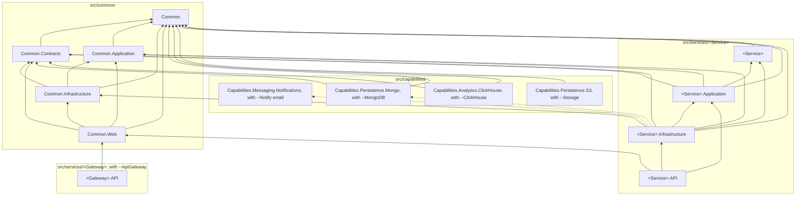

# Проекты и слои

Сгенерированное решение состоит из трёх частей: общих проектов `Common` в `src/common`, которые
генерируются один раз; проекта на каждую возможность, которую приносит флаг, в `src/capabilities`; и папки на
каждый сервис в `src/services`.

Кто на кого ссылается; стрелка указывает на проект, на который ссылаются:

## Common

| Проект | Что содержит | Ссылается на |
|---|---|---|
| `Common` | Доменное ядро: `Entity`, `AggregateRoot`, доменные события, `IUnitOfWork`, спецификации, пользователь и контекст выполнения, исключения | ни на что |
| `Common.Contracts` | То, что пересекает границу сервиса: маршруты, модели запросов и ответов, константы проверок здоровья | `Common` |
| `Common.Application` | Абстракции приложения: диспетчер доменных событий, `IPermissionService`, интерфейсы сообщений | `Common` |
| `Common.Infrastructure` | Базовые классы EF Core, interceptor'ы, репозитории, миграции, schema guard, сообщения на MassTransit, безопасность | `Common`, `Common.Application`, `Common.Contracts` |
| `Common.Web` | Веб-слой сервиса: pipeline, ошибки, валидация, Swagger, аутентификация, права, здоровье | `Common`, `Common.Contracts`, `Common.Application`, `Common.Infrastructure` |
| `Common.Testing` | Тестовые помощники, привязанные к аудит-pipeline: аудит-верификаторы и `TestCategories`; без тестового фреймворка | все перечисленные выше, `Framework.Testing` |
| `Framework.Testing` | Переносимая тестовая система: тестовые контексты, тестовые серверы реальных СУБД решения (`PostgresDbTestExecutionContext`, `SqlServerDbTestExecutionContext`), `TestDatabase`, заглушки, проверки правил; без тестового фреймворка | `Common`, `Common.Application`, `Common.Infrastructure`, `Framework.DomainEvents`, модуль провайдера |
| `Common.Tests` | Тесты `Common` | все перечисленные выше, `Common.Testing` |
| `Framework.Auth` | Аутентификация и авторизация платформы над JwtBearer: составная схема API-ключа или JWT, cookie токена с CSRF-контрактом, проверка прав | `Common`, `Common.Application`, `Common.Infrastructure` |
| `Framework.Auth.Tests` | Тесты аутентификации и прав | `Framework.Auth` |
| `Framework.OpenApi` | Стек Swagger: настройка документа, фильтры, дамп схемы `--ApiDiff` | `Common`, `Common.Contracts` |
| `Framework.OpenApi.Tests` | Тесты стека Swagger | `Framework.OpenApi` |
| `Framework.Validation` | Обвязка FluentValidation над SharpGrip: валидаторы сборки сервиса и ответ 422 | ничего из `Common` |
| `Framework.Validation.Tests` | Тесты обвязки валидации | `Framework.Validation` |
| `Framework.Observability` | Идентификатор корреляции: ambient-значение, имя заголовка, middleware, который читает или создаёт его на запрос, и обработчик, кладущий его в исходящий вызов | ничего из `Common` |
| `Framework.Observability.Tests` | Тесты идентификатора корреляции | `Framework.Observability` |
| `Framework.FeatureFlags`, с `--FeatureFlags` | Платформенные фича-флаги: общий каталог `features.json`, обвязка Microsoft.FeatureManagement, `GET /api/v1/features`, Swagger-фильтры для `[FeatureGate]`. На него ссылается сервис с флагом | ничего из `Common` |
| `Framework.FeatureFlags.Tests` | Тесты фича-флагов | `Framework.FeatureFlags` |
| `Capabilities.Messaging.Notifications` | Почта `--Notify email`: порт, транспорты SMTP и Graph, песочница. На него ссылается сервис с флагом, поэтому MailKit и Graph SDK есть только у этого сервиса | ничего из `Common` |
| `Capabilities.Messaging.Notifications.Tests` | Тесты почты | `Capabilities.Messaging.Notifications`, `Common.Testing` |
| `Capabilities.Persistence.Mongo` | MongoDB `--MongoDB`: хранилище, его настройки, проверка здоровья. На него ссылается сервис с флагом, поэтому драйвер есть только у этого сервиса | `Common`, `Common.Contracts` |
| `Capabilities.Persistence.Mongo.Tests` | Тесты MongoDB | `Capabilities.Persistence.Mongo`, `Common`, `Common.Testing` |
| `Capabilities.Analytics.ClickHouse` | ClickHouse флага `--ClickHouse`: подключения, страж схемы, проверка готовности. На него ссылается сервис с флагом, поэтому драйвер есть только у этого сервиса | `Common`, `Common.Contracts` |
| `Capabilities.Analytics.ClickHouse.Tests` | Тесты ClickHouse | `Capabilities.Analytics.ClickHouse`, `Common`, `Common.Testing` |
| `Capabilities.Persistence.Abstractions` | Контракты персистенции, общие для ядра и провайдеров: `IMigrationLock`, `IShortIdGenerator`, `IOutboxStatsDialect`, `MigrationLockKey` | ни на что |
| `Capabilities.Persistence.S3` | Объектное хранилище флага `--Storage`: `IS3ObjectStorage`, его настройки, null-заглушка. На него ссылается сервис с флагом, поэтому AWS SDK есть только у этого сервиса | `Common` |
| `Capabilities.Persistence.S3.Tests` | Тесты объектного хранилища | `Capabilities.Persistence.S3`, `Common`, `Common.Testing` |
| `Capabilities.Messaging.RabbitMQ` | Шина сообщений `--Messaging outbox` или `direct`: транспорт MassTransit на RabbitMQ, транзакционный outbox и его diagnostics-эндпоинт, консюмеры. На неё ссылается сервис с флагом, поэтому пакеты брокера есть только у этого сервиса | `Common`, `Common.Application`, `Common.Contracts`, `Common.Infrastructure`, `Capabilities.Persistence.Abstractions`, `Framework.Observability` |
| `Capabilities.Messaging.RabbitMQ.Tests` | Тесты шины: перенос актора и трейса, имена эндпоинтов, диагностика outbox | `Capabilities.Messaging.RabbitMQ`, `Common`, `Common.Infrastructure`, `Framework.Testing` |
| `Capabilities.Background.Hangfire` | Фоновые задачи `--Hangfire`: хранилище в схеме сервиса, дашборд, фильтры, переносящие актора и область доменных событий в задачу | `Common`, `Common.Infrastructure`, `Framework.DomainEvents`, `Framework.Observability` |
| `Capabilities.Background.Hangfire.Tests` | Тесты фоновых задач: область доменных событий задачи и переносимый актор | `Capabilities.Background.Hangfire`, `Common`, `Framework.Testing` |

## Форма модуля

У модуля обоих семейств один скелет: свой каталог, проекты внутри него и проект, названный по
модулю. Контракт, пересекающий границу модуля, получает `.Abstractions`; тесты получают
`.Tests`, когда модулю есть что тестировать; модуль, владеющий механизмом, несёт `README.md`.
Версии пакетов, нужные модулю, объявлены в `src/package-versions/<module>.props` и импортируются
`src/Directory.Packages.props`, поэтому флаг, включающий модуль, приносит их с собой. Разводка -
`template.json`, `All.sln` и доки - называет модуль так же. Отличие от скелета допустимо, но
записывается рядом с модулем вместе с причиной.

## Сервис

| Проект | Что содержит | Ссылается на |
|---|---|---|
| `<Service>` | Домен сервиса: сущности, агрегаты, доменные события, политики | `Common` |
| `<Service>.Application` | Use case'ы, обработчики доменных событий, порты, которые реализует инфраструктура | `Common`, `Common.Application`, `Common.Contracts`, домен |
| `<Service>.Infrastructure` | `DbContext`, конфигурации сущностей, репозитории, фоновые задачи, консьюмеры | домен, `Common`, `Common.Application`, `Common.Contracts`, `Common.Infrastructure`, приложение |
| `<Service>.API` | Контроллеры, `Program`, настройка хоста | проекты `Common`, приложение, инфраструктура |
| `<Service>.Tests` | Тесты сервиса | `Framework.Testing`, `Common.Testing`, проекты `Common`, проекты сервиса |

Проект API не ссылается на домен: он работает с доменом через слой приложения, который регистрирует и
доменные сервисы. Слой приложения отвечает типами запросов и ответов из `Common.Contracts` и бросает
исключения из `Common`, поэтому ссылается на оба; инфраструктура ссылается на `Common.Contracts` ради
сообщений шины, которые принимают её консьюмеры. Инфраструктура ссылается на домен напрямую, потому что EF Core маппит сущности домена и
отдельных моделей хранения, которые пришлось бы переводить, нет.

## Каждая ссылка явная

`Directory.Build.props` включает `DisableTransitiveProjectReferences`. Проект видит только те проекты,
на которые ссылается сам, а не проекты, на которые ссылаются они. Без этого проект API мог бы
использовать доменный тип через проект приложения, и описанные выше слои держались бы, только пока никто
не попробовал. С этим пересечение слоя - ошибка компиляции, а новая зависимость - видимая строка в
`.csproj`.

Пакеты по-прежнему подтягиваются транзитивно; отрезаны только ссылки на проекты.

## Пакеты и версии

Версии пакетов объявлены один раз, в `src/Directory.Packages.props` или в файле, который он подключает;
`.csproj` называет пакет без версии. Все пакеты остаются на линейке .NET 8: ни один не тянет библиотеку .NET 9, ни напрямую, ни
транзитивно, поэтому часть пакетов держится ниже последней версии.

Версии, которые приносит флаг - база данных, `--Notify`, `--MongoDB` и остальные, - лежат в отдельном файле
`src/package-versions/<флаг>.props`, а `Directory.Packages.props` подключает такие файлы по маске: флаг
добавляет файл и общий не трогает.
