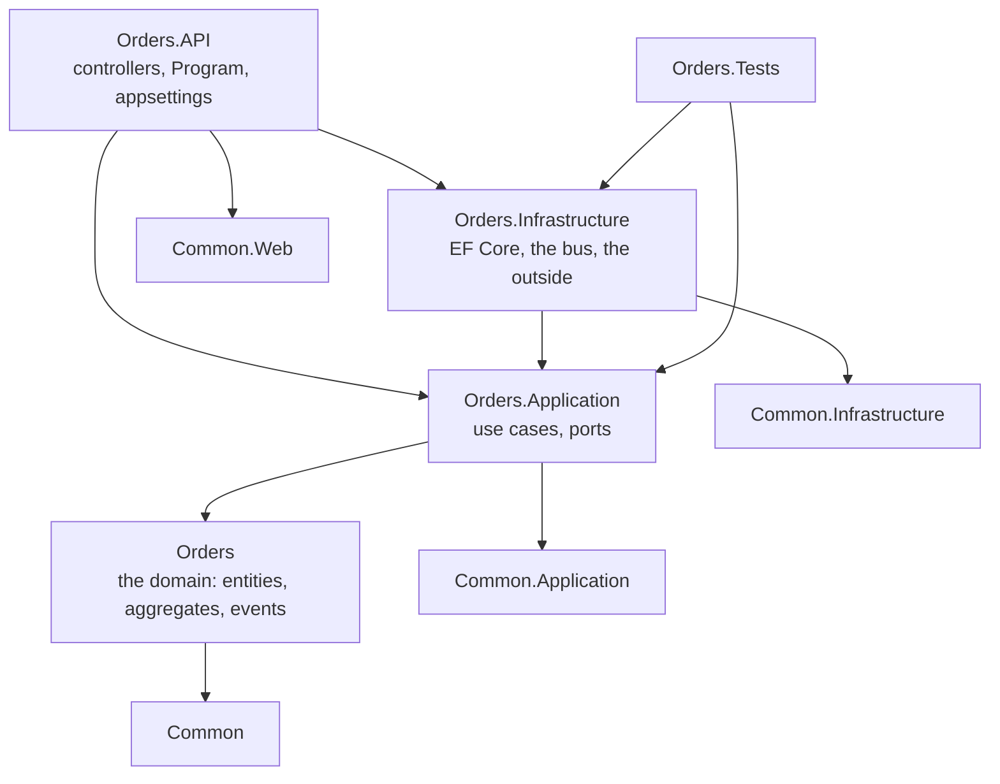
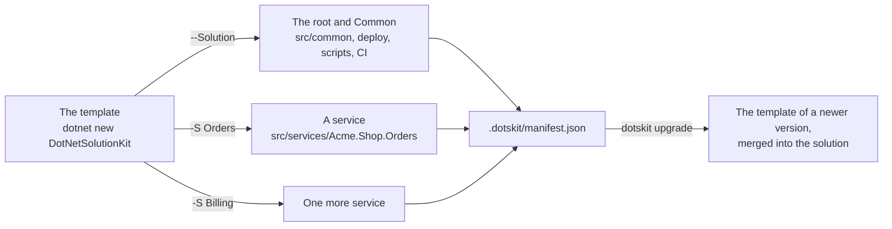

# The layout of a solution

What a generated solution looks like on disk, which file matters and where the team's code goes. The names below
come from the generation: `-N Acme -P Shop -S Orders` gives `Acme.Shop.Common`, `Acme.Shop.Orders` and
`src/services/Acme.Shop.All.sln`.

## The folders

```
acme-shop/
├── .dotskit/manifest.json         what the solution was generated from; dotskit reads it on every run
├── Directory.Build.props          the properties of every project, and DotNetSolutionKitVersion
├── Dockerfile                     one image for every service
├── version.json                   the product's version, set by hand
├── src/
│   ├── Directory.Packages.props   the version of every package, declared once
│   ├── package-versions/*.props   the versions a flag brings, a file per flag
│   ├── common/                    what the services share
│   │   ├── Acme.Shop.Common/                  the domain's primitives: entities, aggregates, events, Money
│   │   ├── Acme.Shop.Common.Contracts/        what crosses the boundary: requests, responses, bus messages
│   │   ├── Acme.Shop.Common.Application/      use cases over the domain, the ports they need
│   │   ├── Acme.Shop.Common.Infrastructure/   EF Core, the bus, the secret store, the outside world
│   │   ├── Acme.Shop.Common.Web/              the host: pipeline, errors, Swagger, authentication
│   │   ├── Acme.Shop.Common.Testing/          the test harness, with no test framework
│   │   └── Acme.Shop.Common.Tests/            the tests of Common
│   ├── capabilities/              a project per flag: Capabilities.Mongo, Capabilities.Notifications
│   └── services/
│       ├── Acme.Shop.All.sln      every project of the solution
│       └── Acme.Shop.Orders/      one service, four projects (below)
├── gateway/                       the API gateway, with --ApiGateway
├── deploy/
│   ├── compose/                   docker compose: the services, and infra/ a file per part
│   ├── k8s/                       the manifests, with --Deploy k8s
│   └── build-images.sh            builds the image of every service
├── tests/servers/                 the test servers: start, ready, logs, down; up.sh starts them all
├── scripts/                       the checks and the schemas of the solution
├── tools/                         the development tools of the solution
├── .github/workflows/             CI, with --GitHubCiCd
└── CLAUDE.md                      the rules an AI agent of this solution works by
```

## One service

A service is four projects, and the dependencies between them point inward: nothing in the domain knows the
web, and nothing in the application layer knows EF Core.



| Project | What is in it | What the team writes here |
|---|---|---|
| `Acme.Shop.Orders` | the domain: entities, aggregates, domain events, specifications | the model of the product |
| `Acme.Shop.Orders.Application` | use cases, the ports they call | what the product does, step by step |
| `Acme.Shop.Orders.Infrastructure` | the `DbContext`, repositories, the bus, integrations | how it reaches the outside |
| `Acme.Shop.Orders.API` | controllers, `Program.cs`, the settings | the endpoints |
| `Acme.Shop.Orders.Tests` | the tests of this service | what proves the above |

## The template and a solution

The template generates `Common` and the root once, and a service per run; `dotskit` keeps a manifest of what
was generated and merges a newer version of the template into the solution later.



A flag adds its own project under `src/capabilities` and its versions under `src/package-versions`, and the
services that use it reference it - so a service carries only the packages of its own flags.
