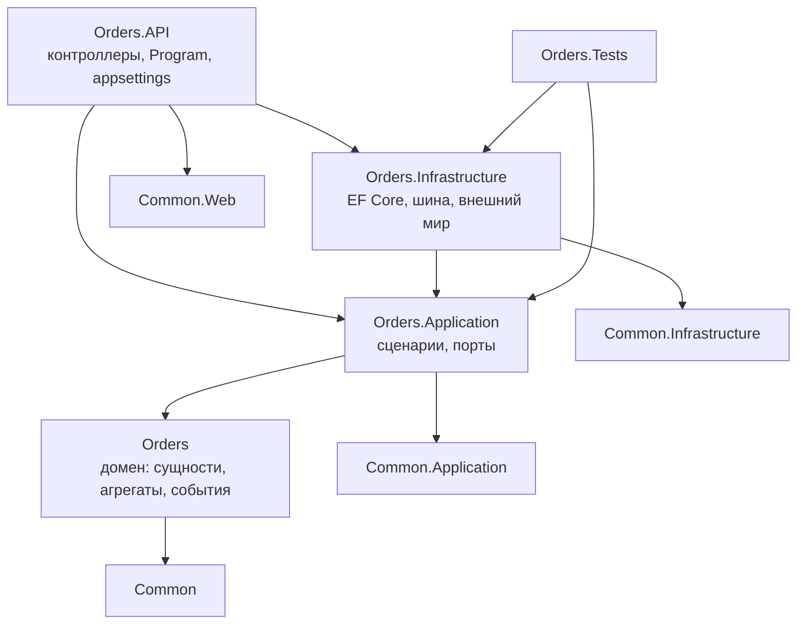
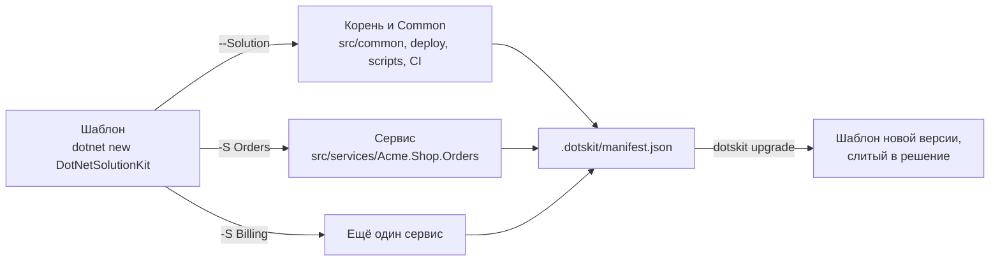

# Устройство решения

Как сгенерированное решение выглядит на диске, какой файл за что отвечает и где живёт код команды. Имена ниже
берутся из генерации: `-N Acme -P Shop -S Orders` даёт `Acme.Shop.Common`, `Acme.Shop.Orders` и
`src/services/Acme.Shop.All.sln`.

## Папки

```
acme-shop/
├── .dotskit/manifest.json         из чего сгенерировано решение; dotskit читает его на каждом запуске
├── Directory.Build.props          свойства всех проектов и DotNetSolutionKitVersion
├── Dockerfile                     один образ на все сервисы
├── version.json                   версия продукта, ставится руками
├── src/
│   ├── Directory.Packages.props   версия каждого пакета, объявленная один раз
│   ├── package-versions/*.props   версии, которые приносит флаг, по файлу на флаг
│   ├── common/                    то, что общее у сервисов
│   │   ├── Acme.Shop.Common/                  примитивы домена: сущности, агрегаты, события, Money
│   │   ├── Acme.Shop.Common.Contracts/        то, что пересекает границу: запросы, ответы, сообщения шины
│   │   ├── Acme.Shop.Common.Application/      сценарии над доменом и порты, которые им нужны
│   │   ├── Acme.Shop.Common.Infrastructure/   EF Core, шина, хранилище секретов, внешний мир
│   │   ├── Acme.Shop.Common.Web/              хост: конвейер, ошибки, Swagger, аутентификация
│   │   ├── Acme.Shop.Common.Testing/          тестовая оснастка, без тестового фреймворка
│   │   └── Acme.Shop.Common.Tests/            тесты Common
│   ├── capabilities/              проект на флаг: Capabilities.Mongo, Capabilities.Notifications
│   └── services/
│       ├── Acme.Shop.All.sln      все проекты решения
│       └── Acme.Shop.Orders/      один сервис, четыре проекта (ниже)
├── gateway/                       шлюз API, при --ApiGateway
├── deploy/
│   ├── compose/                   docker compose: сервисы и infra/ по файлу на часть
│   ├── k8s/                       манифесты, при --Deploy k8s
│   └── build-images.sh            собирает образ каждого сервиса
├── tests/servers/                 тестовые серверы: start, ready, logs, down; up.sh поднимает все
├── scripts/                       проверки и схемы решения
├── tools/                         инструменты разработки решения
├── .github/workflows/             CI, при --GitHubCiCd
└── CLAUDE.md                      правила, по которым работает ИИ-агент этого решения
```

## Один сервис

Сервис - это четыре проекта, и зависимости между ними направлены внутрь: домен ничего не знает про веб, а
слой сценариев - про EF Core.



| Проект | Что внутри | Что здесь пишет команда |
|---|---|---|
| `Acme.Shop.Orders` | домен: сущности, агрегаты, доменные события, спецификации | модель продукта |
| `Acme.Shop.Orders.Application` | сценарии и порты, которые они вызывают | что продукт делает, по шагам |
| `Acme.Shop.Orders.Infrastructure` | `DbContext`, репозитории, шина, интеграции | как он достаёт внешний мир |
| `Acme.Shop.Orders.API` | контроллеры, `Program.cs`, настройки | endpoints |
| `Acme.Shop.Orders.Tests` | тесты этого сервиса | то, что доказывает написанное выше |

## Шаблон и решение

Шаблон генерирует `Common` и корень один раз, а сервис - за запуск; `dotskit` держит манифест того, из чего
сгенерировано решение, и позже сливает в него новую версию шаблона.



Флаг добавляет свой проект в `src/capabilities` и свои версии в `src/package-versions`, а сервисы, которые им
пользуются, ссылаются на него - поэтому сервис несёт только пакеты своих флагов.
