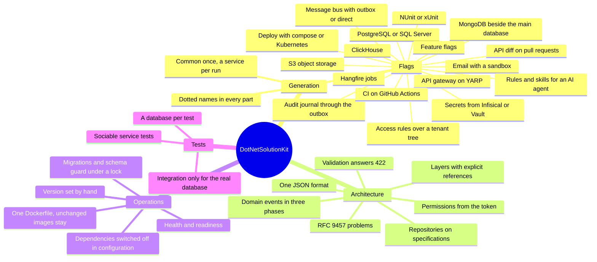

# What DotNetSolutionKit gives

A team receives a production-ready foundation: the architecture, the infrastructure, the quality checks and the
rules for working with the system. A solution is generated to the needs of the product.

Production-ready here is a list, not a claim. What an enterprise otherwise builds for itself before the first
feature is already in place and already checked: persistence with migrations and transactions, a message bus
with an outbox, background jobs, secrets in a store instead of a config, feature flags, an audit trail,
structured logs and health endpoints, an error contract to RFC 9457, authentication with permissions and access
rules over a tenant tree, generated API schemas with a diff against the previous one, a test harness with real
servers in containers, images and deployment to compose or Kubernetes, and CI that runs all of it.

DotNetSolutionKit is a `dotnet new` template for .NET 8 microservices. It generates shared Common libraries
and services in which layering, error handling, validation, persistence, domain events, background jobs,
testing and deployment are already in place. CI on GitHub Actions and everything else are enabled by flags.

## Flexibility

At generation time, a solution selects what it needs: PostgreSQL or SQL Server, Infisical or Vault, NUnit or
xUnit, the API gateway, the message bus, auditing. As the project grows, new capabilities are added alongside
the existing ones.

## Only business logic left to verify

The infrastructure is verified by the template's own tests and CI, and by runs of the generated solutions. The
team's reviews and tests focus on the rules of its domain.

## Principles

- The product is the generated solution, and that is what gets verified.
- At runtime, a service writes nothing to disk.
- With a secret store (Infisical or Vault), secrets reside only in the store and in the service's memory.
- The choice between libraries is made in one place.
- Every capability can be switched off cleanly, leaving nothing behind.

## AI agents

Skills describe the architecture's invariants to an AI agent and show how to write code without violating
them: [working with AI agents](agents.md).

## No business logic, only what it is written on

The template carries no domain: not one entity, not one use case, not one rule of a business. What it carries
is the frame those are written in - the layers as separate projects, aggregates, domain events, specifications,
the repository over them - and a folder structure where code written by the book has an obvious place.

So DDD and Clean Architecture here are a readiness, not a demand. A team that works that way finds the
mechanisms already in place and spends its time on the model. A team that does not writes as it sees fit, and
nothing refuses to build because a handler was not a use case.

That is why the size of the system does not matter: a monolith, one web service, or a high-load set of
microservices. The capabilities are chosen by flags, and how strict the architecture is stays the team's call.

For a team lead - and for a tech lead or an architect - that is free hands, not a cage. The groundwork that usually eats the first
months - the layers, the persistence, the error contract, the pipeline, CI, deployment, the test harness - is
already there and already checked, and every decision on top of it stays theirs: which rules to hold the team
to, which capabilities to switch on, what to write differently, and whether to take a newer version of the
template at all. Nothing in a generated solution asks permission from the template. In exchange the template does fix one thing: how the code is laid out. A
service is four projects with the dependencies pointing inward, `Common` is a project per layer, a capability
is a project of its own, and the names carry the solution's dots. A team that wants a different layout rewrites
it and loses the upgrades, because that layout is what the merge and the repairs are written against.

## Decisions rather than ready-made domains

Billing for network traffic, for an online store and for SaaS are different domain models. No single template
covers them.

The template will provide architectural decisions and the primitives they rely on: money in fixed-point
arithmetic, `Money` with its currency, an issued document as an immutable snapshot, policies for changing
payment details ([planned](https://github.com/sawking-tech/DotNetSolutionKit/issues/76)).

The team builds the model of its specific domain itself.

## Economics

What the template hands over is 524 files, about 18,000 lines of code and 203 tests of `Common` - a foundation
a team would otherwise write before its first feature.

How long that takes depends on the configuration, but a structure thought through over several iterations takes
at least four months, and polishing it after the first services land takes another two. Two developers, six
months, twelve person-months of direct work.

The rest of the team is neither idle nor productive in those months: they test and agree on the infrastructure
instead of the product, and a release waits on the developers. Meanwhile the owner pays all of it - every
salary, the rent, the licences and whatever else runs monthly - while the product is not being written yet, or,
in a team that works by the book, is written but cannot be raised in full. Counting that indirect time, a team
of five running eight services spends 16-31 person-months in the first year. At Dutch rates the labour alone is
€50,000-110,000: a developer earns €5,000 gross a month, plus 25-45% in employer costs on top
([Deel](https://www.deel.com/blog/employer-costs-for-an-employee-in-the-netherlands/)). The original
[calculation](https://sawking.tech/cv) at Moscow rates comes to 2.5-5 million rubles.

The arithmetic, so it can be argued with. A person-month of a developer costs €6,250-7,250 (€5,000 gross plus
25-45%), so 16-31 person-months of foundation work are €100,000-225,000 of payroll. The template takes about
half of that: the configuration, the flags, the team's own integrations and learning the solution stay the
team's work. That is where €50,000-110,000 comes from.

Company-wide the bill is larger than payroll, and the larger part is not the template's to claim: the rent, the
licences and every other monthly cost run through those months as well, and the product earns nothing while it
cannot be raised in full. How much that is depends on the product, so it is not counted here - what the
template changes is when the dev environment appears, and that is the first day instead of the fifth month.

Who this does not count. A team with a settled process already has a template of its own, and this one has
nothing to offer it - no argument here is aimed at that team, and "we can do the same in a week" is true for
them. The question that stays interesting is a different one: how does such a team add a new integration to its
own frame, and how does it carry a change of the frame into the projects already generated from it. That is the
part `dotskit upgrade` does, and the part usually done by copying.

The part that is not money is the risk. The longer there is nothing running, the more of the plan turns out
never to happen. With the template a dev environment is up on the first day, the business logic starts being
written while the foundation is already there, and its bugs are found early instead of after the infrastructure
is finally finished.

Additional savings:

- fewer infrastructure incidents;
- faster onboarding;
- faster launch of new services;
- updates and fixes are made once for all services;
- the time freed up can go to new projects.

The savings grow with how fully the project uses the template.

## Cost

The foundation works from day one.

Beyond the foundation, the team needs expertise in DDD, clean architecture and distributed systems: the
outbox, idempotency, eventual consistency, compensating actions.

A service stays simple until its domain needs these mechanisms.

The cost of the team must account for this expertise. Engineers who can build such systems command higher
rates.

## Risks

**1. A team may take on more than it can maintain.**
The template can bring such a team to a working system. If the team does not understand the architectural
decisions, support will have to be reinforced with specialists.

**2. Strong engineers become more expensive.**
A team may grow on the project, gain experience with distributed systems and leave with the tool. The MIT
license allows this.

**3. The baseline of expected expertise rises.**
As advanced architectural decisions become more accessible, the market starts expecting them from more
engineers. Quality becomes the norm.

The author believes the value for the business outweighs these risks.

## Quality assurance

The template's CI generates solutions in combinations that enable every flag at least once, builds them and
runs their tests. In the combinations with integration tests, the checks run against real servers and with the
workflows the solution ships with.

The generated solutions are published in
[DotNetSolutionKit.Samples](https://github.com/sawking-tech/DotNetSolutionKit.Samples). They are regenerated
after every release, and once a day when the working branch has moved, and their CI runs on GitHub.
