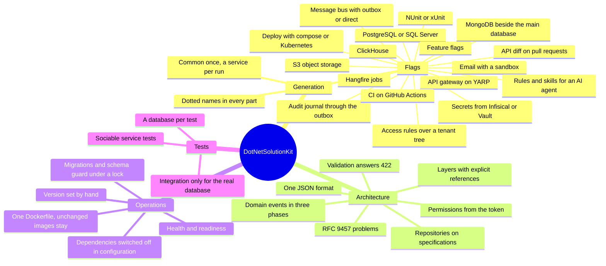

# Что даёт DotNetSolutionKit

Команда получает production-ready фундамент: архитектуру, инфраструктуру, проверки и правила работы с
системой. Решение генерируется под потребности продукта.

Production-ready здесь - это список, а не заявление. То, что энтерпрайз иначе строит себе сам до первой фичи,
уже стоит и уже проверено: персистентность с миграциями и транзакциями, шина сообщений с outbox, фоновые
задачи, секреты в хранилище вместо конфига, фича-флаги, аудит, структурные логи и health-эндпоинты, контракт
ошибок по RFC 9457, аутентификация с правами и правилами доступа по дереву тенантов, генерация схем API с
диффом против предыдущей, тестовая оснастка с настоящими серверами в контейнерах, образы и развёртывание в
compose или Kubernetes, и CI, который всё это прогоняет.

DotNetSolutionKit - шаблон `dotnet new` для микросервисов на .NET 8. Он генерирует общие библиотеки Common и
сервисы, где уже решены слои, ошибки, валидация, хранение, доменные события, фоновые задачи, тесты и деплой.
CI на GitHub Actions и остальное подключается флагами.

## Пластичность

При генерации решение берёт нужное: PostgreSQL или SQL Server, Infisical или Vault, NUnit или xUnit, шлюз,
шину, аудит. Когда проект растёт, новые возможности добавляются рядом с уже существующими.

## Проверяется только бизнес-логика

Инфраструктуру проверяют тесты и CI шаблона, а также прогоны сгенерированных решений. Ревью и тесты команды
заняты правилами домена.

## Принципы

- Продукт - сгенерированное решение, и именно оно проверяется.
- В рантайме сервис ничего не пишет на диск.
- С хранилищем секретов (Infisical или Vault) секреты живут только в нём и в памяти сервиса.
- Выбор между библиотеками держится в одном месте.
- Каждая возможность выключается без хвостов.

## Агент

Скиллы описывают агенту инварианты архитектуры и показывают, как писать код, не нарушая её: [работа с
ИИ-агентами](agents.md).

## Бизнес-логики нет, есть то, на чём её пишут

Шаблон не несёт предметной области: ни одной сущности, ни одного сценария, ни одного бизнес-правила. Он несёт
каркас, в котором их пишут, - слои отдельными проектами, агрегаты, доменные события, спецификации, репозиторий
над ними - и структуру папок, где коду по канонам есть очевидное место.

Поэтому DDD и чистая архитектура здесь - готовность, а не требование. Команда, которая так работает, находит
механизмы на месте и тратит время на модель. Команда, которая так не работает, пишет как считает нужным, и
ничего не перестаёт собираться из-за того, что обработчик не стал use case.

Поэтому размер системы не имеет значения: монолит, один веб-сервис или хайлоад из микросервисов. Возможности
выбираются флагами, а строгость архитектуры остаётся решением команды.

Тимлиду - а с ним техлиду и архитектору - это развязывает руки, а не связывает. Фундамент, который обычно съедает первые месяцы -
слои, персистентность, контракт ошибок, конвейер, CI, развёртывание, тестовая оснастка - уже стоит и уже
проверен, а каждое решение над ним остаётся за ними: каких правил держать команду, какие возможности включить,
что написать иначе и брать ли вообще новую версию шаблона. Ничто в сгенерированном решении не спрашивает
разрешения у шаблона. Взамен шаблон всё же задаёт одно: раскладку кода. Сервис - четыре проекта с
зависимостями внутрь, `Common` - проект на слой, возможность - свой проект, а имена несут точки решения.
Команда, которой нужна другая раскладка, переписывает её и теряет обновления: именно под эту раскладку
написаны слияние и починки.

## Решения вместо готовых доменов

Биллинг трафика, магазина и SaaS - разные предметные модели. Общего шаблона для них нет.

Шаблон даст архитектурные решения и примитивы, на которых они держатся: деньги в арифметике с фиксированной
точкой, `Money` с валютой, выставленный документ как неизменный снимок, правила смены платёжных реквизитов ([в
планах](https://github.com/sawking-tech/DotNetSolutionKit/issues/76)).

Модель конкретного домена команда строит сама.

## Экономика

Шаблон отдаёт 524 файла, около 18 000 строк кода и 203 теста `Common` - фундамент, который команда иначе
пишет до первой фичи.

Сколько это занимает, зависит от конфигурации, но продуманная за несколько итераций структура - это минимум
четыре месяца, а её доводка и полировка после первых сервисов - ещё два. Двое разработчиков, полгода,
двенадцать человеко-месяцев прямой работы.

Остальные в эти месяцы не простаивают, но и продукт не двигают: они тестируют и согласовывают инфраструктуру
вместо продукта, а выпуск ждёт разработчиков. При этом владелец платит всё - зарплаты всем, аренду, лицензии и
прочие постоянные платежи, - пока продукт ещё не пишется или, если команда работает по книгам, пишется, но не
может быть поднят полноценно. С этим косвенным временем команда из пяти человек, которая ведёт восемь
сервисов, тратит за первый год 16-31 человеко-месяц. По голландским ставкам один труд стоит €50-110 тыс.:
разработчик получает €5 000 gross в месяц, сверху ещё 25-45% расходов работодателя
([Deel](https://www.deel.com/blog/employer-costs-for-an-employee-in-the-netherlands/)). Исходный
[расчёт](https://sawking.tech/cv) по московским ставкам даёт 2,5-5 млн ₽.

Арифметика, чтобы с ней можно было спорить. Человеко-месяц разработчика стоит €6 250-7 250 (€5 000 gross плюс
25-45%), значит 16-31 человеко-месяц работы над фундаментом - это €100-225 тыс. фонда оплаты. Шаблон снимает
примерно половину: конфигурация, флаги, собственные интеграции и освоение решения остаются работой команды.
Отсюда и €50-110 тыс.

По компании счёт больше фонда оплаты, и большую его часть шаблон себе не присваивает: аренда, лицензии и все
остальные месячные платежи идут те же месяцы, а продукт не зарабатывает, пока его нельзя поднять полноценно.
Сколько это - зависит от продукта, поэтому здесь не считается; шаблон меняет другое - когда появляется
dev-стенд, и это первый день вместо пятого месяца.

Кого этот счёт не касается. У команды с отлаженным процессом уже есть свой шаблон, и наш ей незачем - ни один
довод здесь к такой команде не обращён, и «мы это сделаем за неделю» для неё правда. Интересным остаётся другое:
как такая команда добавляет в свой каркас новую интеграцию и как доводит изменение каркаса до проектов, которые
с него уже сгенерированы. Это та часть, которую делает `dotskit upgrade`, и та, которую обычно делают копированием.

То, что не деньги, - это риск. Чем дольше ничего не работает, тем большая часть плана не сбывается никогда. С
шаблоном dev-стенд поднимается в первый день, бизнес-логика начинает писаться, когда фундамент уже стоит, и её
баги находятся рано, а не после того, как инфраструктура наконец готова.

Дополнительная экономия:

- меньше инфраструктурных инцидентов;
- быстрее онбординг;
- быстрее запуск новых сервисов;
- обновления и исправления делаются один раз для всех сервисов;
- освободившееся время можно направить на новые проекты.

Экономия растёт с тем, насколько полно проект использует шаблон.

## Цена

Каркас работает с первого дня.

Сверх каркаса нужны компетенции в DDD, чистой архитектуре и распределённых системах: outbox, идемпотентность,
конечная согласованность, компенсации.

Сервис остаётся простым, пока домену эти механизмы не нужны.

Стоимость команды должна учитывать эти компетенции. Инженеры, которые умеют строить такие системы, стоят
дороже.

## Риски

**1. Команда может взять больше, чем умеет поддерживать.**
Шаблон способен довести такую команду до работающей системы. Если архитектурные решения ей непонятны,
поддержку придётся усиливать специалистами.

**2. Сильные инженеры становятся дороже.**
Команда может вырасти на проекте, получить опыт распределённых систем и уйти вместе с инструментом. Лицензия
MIT это позволяет.

**3. Растёт минимальный уровень компетенций.**
Когда сложные архитектурные решения становятся доступнее, рынок начинает ожидать их от большего числа
инженеров. Качество становится нормой.

Автор считает, что польза для бизнеса перекрывает эти риски.

## Как это держится

CI шаблона генерирует решения в комбинациях, где каждый флаг включён хотя бы раз, собирает их и гоняет тесты.
В комбинациях с интеграционными тестами проверки идут на настоящих серверах и с поставляемыми workflow.

Сгенерированные решения лежат в
[DotNetSolutionKit.Samples](https://github.com/sawking-tech/DotNetSolutionKit.Samples), пересобираются после
каждого выпуска и раз в сутки, если рабочая ветка сдвинулась, а их CI работает на GitHub.
